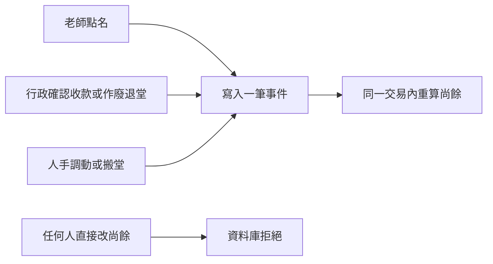

# 已繳堂數改為只交事件

給 IT 專家的完整方案（背景、注意事項、考慮因素、最終方案）已整理於 [`entitlement-remaining-event-ledger.md`](../../product/topics/entitlement-remaining-event-ledger.md)。本檔保留當日討論手記。

| 欄位 | 值 |
| --- | --- |
| 日期 | 2026-11-15 |
| 狀態 | 方向已對齊；未實作；未改庫；未重算現有差額。專家審閱稿見上列分題 |
| 讀者 | 討論 P1-2 的另一位 agent，以及之後實作的人 |
| 來源 | 同日稽核 [`2026-11-15-system-health.md`](./2026-11-15-system-health.md) 的 P1-4，並回應 P1-2 |
| 不改 | 不開申請制。分題 [`entitlement-correction-approval.md`](../../product/topics/entitlement-correction-approval.md) 仍是 `open`，本檔不改它的狀態 |

## 目前問題

已繳堂數的尚餘存在 `student_entitlement_pools.remaining_lessons`。學費追收看這個數字，不看事件加總。

兩件事是同一個裂口的兩面：

| 編號 | 現象 |
| --- | --- |
| P1-2 | 2627 專科 166 口紀錄中，22 口的尚餘不等於消耗事件淨額加調動。21 口偏高、1 口偏低，差距合計 +58 堂。計費出席與消耗事件一致，是尚餘欄沒跟上。追收會少算已扣堂。稽核未能還原是哪一次改了尚餘卻沒寫事件 |
| P1-4 | 登入後可用 Data API 直接改尚餘。稽核只讀了 live 政策，沒有對真人列下 UPDATE |

產品（2026-08-15 M19）寫的是：直接改尚餘只限外星人（`entitlements.correct`）。資料庫沒有這樣做。

職員 UPDATE 政策是：行政、管理層、財務或外星人，而且具備 `attendance.take`、`students.enroll`、`payments.create`、`entitlements.correct` 任何一項。行政與管理層有前三項、沒有第四項，仍然可以更新任何一列。財務沒有這四項，改不到。老師另有一條：有 `attendance.take`，且該列 `class_id` 是自己可進入的班；trigger 禁止老師改身份欄，但明確允許改尚餘。職員不經這個 trigger。

點名扣堂的函式 `apply_attendance_entitlement_delta` 會鎖列、改尚餘、並寫入 `entitlement_consumption_events`。它是 `SECURITY DEFINER`，只約束「有人呼叫這個函式」。表的 UPDATE 仍開著，所以直接 PATCH 尚餘不會進這個函式，也不寫事件。

確認收款加堂、作廢後退堂、更正頁增減或搬堂，是瀏覽器先讀尚餘、在本地加上堂數、再寫回，然後才插事件或調動列。兩步不在同一個資料庫交易。兩個人同時讀到同一個數字時，後寫入的蓋掉先寫入的。更正頁若第一步成功、第二步因沒有 `entitlements.correct` 而失敗，尚餘已經變了，調動列沒有。

作廢學費單已經不准 Data API 把狀態改成作廢，必須走 `void_payment_command`。尚餘沒有同等的閘。

## 討論過程

1. **稽核建議。** 表 UPDATE 收窄至 `entitlements.correct`；點名消耗只走 DEFINER 函式。這能關 P1-4，但沒說清抬池、扣回、更正頁現在也是直接改欄，收窄前要先搬走，否則確認收款和作廢退堂會一併失敗。

2. **改成白話。** 問題是尚餘可以直接改，而且可以不留紀錄。改完之後，尚餘仍隨收款和點名變動，但每一次都要留下對應的帳。不另建申請批准。行政與管理層在申請制做好之前維持改不到，是 M19 已接受的空窗；本討論後來不把「補上申請制」當解法。

3. **第一性原則。** 不要為了堵住直接改欄而加一道日常手續。同類產品（堂數、課程學分）不讓人改餘額本身，只記一筆交易：收款加堂、點名扣堂、人手調動。餘額跟著交易變。人手調動要填原因。審批留給作廢、退款這類已有門檻的動作。明學作廢超過 30 分鐘要第二人，已經是這一種。現有更正頁已要求原因和備註。另建「行政申請、外星人批准」多一道手續，又不能堵住 Data API。

4. **使用者提出的模型（同時在與另一位 agent 討論 P1-2）。** 每位學生有一本帳。老師、行政只可交出事件，例如老師扣堂、行政收款後加堂，不能直接改尚餘。系統收到事件後自行重算這個數字。這樣同時操作時，不會互相蓋掉。

5. **對這個模型的判斷。** 可以，而且同時處理 P1-4 與以後的 P1-2。條件是資料庫拒絕直接改尚餘，不能只改畫面。已多出的 58 堂不會因新寫法自動消失，要另做一次按帳本重算。

人手調動由誰發出，討論中提過兩個做法，使用者取消了選擇，**尚未拍板**：

- 行政、管理層、外星人都可以，與能開學費單的人相同，不建申請制。
- 只有外星人可以。行政與管理層改不到，也不另建申請隊列。

使用者最後舉的例子只涵蓋老師扣堂、行政收款加堂。更正頁的增減與搬堂仍應是事件，但是誰可發，沿用上面未拍板的一題。

## 方案

尚餘不是給人改的欄。它是帳本算出來的結果。

- 老師點名、確認收款加堂、作廢退堂、更正頁增減或搬堂，都只交一筆事件。
- 寫入事件與重算尚餘在同一筆交易。重算用該口紀錄的全部事件（或在鎖住該列時只加這一次的增減）。後來的事件不蓋掉前面的。
- 任何角色對 `remaining_lessons` 的直接更新都拒絕，包括外星人。外星人要調堂數，也是交一筆帶原因的事件。
- 現有瀏覽器「先讀尚餘再寫回」的路徑要改為呼叫上述交易。涉及：`topUpEntitlementsForPayment`、`clawbackEntitlementsForPayment`、`adjustEntitlementPool`、`transferEntitlementLessons`，以及 `entitlementQueries.ts` 裡把舊年級紀錄併入的更新。點名函式已鎖列並寫事件，改為與這條閘一致即可，不必另做點名流程。
- 已經對不上的 22 口，上線時按消耗事件與調動重算一次尚餘。這是補歷史，不是新的日常流程。

不做的事：申請隊列、第二人批准每一次調動、讓畫面繼續直接 PATCH 尚餘。

## 改完應有的結果

- 老師點名：出席若要扣堂，尚餘減少，並留下扣堂事件。老師不能把尚餘改成任意數字。
- 確認收款、作廢單據：堂數照舊加減，而且一定有入帳或退回事件。
- 人手更正：尚餘改變，並留下原因。誰可以發這筆事件，見上一節尚未拍板的一題。
- 兩個人同時交事件：兩筆都留下，尚餘等於兩筆的合計，不會只剩後一筆。
- 學費追收的尚餘等於入帳減去扣堂、再加上有紀錄的調動。沒有事件的改動不再出現。
- 直接 PATCH `remaining_lessons` 被拒絕。

## 相關

- 稽核 P1-2、P1-4：[`2026-11-15-system-health.md`](./2026-11-15-system-health.md)
- 直接改只限外星人、申請制另題：[`p0-1-authorization-decisions.md`](../../product/topics/p0-1-authorization-decisions.md) M19、[`entitlement-correction-approval.md`](../../product/topics/entitlement-correction-approval.md)
- 現有更正頁：[`payment-entitlement-correction-ui.md`](../../product/topics/payment-entitlement-correction-ui.md)
